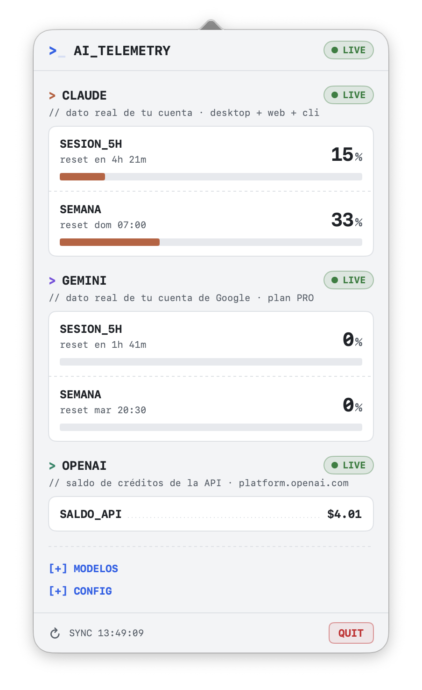

# Claude Menubar Telemetry

A native macOS menu bar utility that provides real-time token usage and subscription-quota telemetry for **Claude Code** and **Gemini CLI**.

The interface is styled with a developer-centric, dark-mode **JetBrains Mono IDE** aesthetic, featuring custom monospaced typography, clean console tables, and terminal-like indicators.

<div align="center">
  
</div>

---

## Key Features

- **100% Native Swift/SwiftUI**: Compiled directly to a lightweight macOS app bundle (no heavy Electron wrappers). Launches instantly and consumes **< 20MB of RAM**.
- **Zero Setup Log Aggregator**: Automatically watches and parses your local Claude Code sessions stored in `~/.claude/projects/` line-by-line. No Anthropic API keys or proxies are required.
- **Real account-wide quota (optional)**: If you're signed in to Claude Code on this Mac, the app reuses that existing session to read your *actual* rate-limit usage across Desktop, web and CLI combined — not just an estimate from local CLI logs. See [Privacy & Safety](#privacy--safety) for exactly what that involves.
- **Usage credits**: Models billed against credits rather than the weekly plan quota (Fable, most notably) are tracked where they actually live — your monthly credit limit, how much of it you've spent, what's left, and any prepaid balance on the account.
- **Gemini too**: A second tab shows Gemini's real daily quota per model (Pro, Flash, Flash Lite…) with its reset countdown, read from the session Gemini CLI already has on this Mac, plus local activity (prompts and tokens over 24h / 7 days, per model) from Gemini CLI's own conversation logs.
- **Per-model weekly windows**: When Anthropic publishes a separate weekly window for a model, it gets its own progress bar instead of a made-up percentage.
- **Live Reset Countdown**: Shows exactly when your current 5-hour session window resets, ticking down in real time.
- **Multi-Model Breakdown**: Automatically groups and lists token usage and requests count per model (Claude Fable, Sonnet, Opus, etc.).
- **No Keychain password prompts**: The Claude Code session is read through `/usr/bin/security`, the same tool Claude Code uses to store it, so macOS hands it over without asking — not once a day, not after every token refresh.
- **JetBrains Mono UI**: Designed to blend into a developer's workspace with dark slate backgrounds (`#1E1F22`), grid borders (`#43454A`), and terminal indicators.

---

## Design Showcase

The app uses the following JetBrains IDE color palette:
- **Background**: Deep Slate `#1E1F22`
- **Fields/Panels**: Lighter Slate `#2B2D30`
- **Grid Lines**: Muted Gray `#43454A`
- **Success Accent**: Emerald Green `#59A869`
- **Focus Accent**: Royal Blue `#3574F0`

The whole popover follows the terminal look of its title bar: `SNAKE_CASE` labels, `>` section prompts, `// comments` for context and segmented meters instead of plain progress bars. When you click the Menu Bar icon (`terminal` system icon):
1. **Header**: `>_ AI_TELEMETRY` with the state of the selected tab (`● LIVE`, `● LOGS_ONLY`, `● HIGH_USAGE` or `● RATE_LIMITED`).
2. **Tabs**: `[CLAUDE]` and `[GEMINI]`, each with its headline percentage. The last tab you used is remembered.
3. **Claude tab**:
   - `CUOTA_CLAUDE`: 5-hour session meter with its real reset countdown, all-models weekly meter and one meter per model-scoped weekly window the account actually has. Without a live session it degrades to a plain Fable requests/tokens counter rather than inventing a percentage.
   - `CREDITOS_USO`: Monthly credit limit, spent so far, remaining, and prepaid balance when the account has one.
   - `MODELOS`: Prompts and tokens per model from the Claude Code logs.
4. **Gemini tab**:
   - `CUOTA_GEMINI`: One meter per model with the share of today's quota used, how many requests remain when Google reports it, and the reset countdown. The comment line shows your plan and Google account.
   - `ACTIVIDAD_LOCAL`: Prompts and tokens from Gemini CLI over the last 24 hours and 7 days.
   - `MODELOS_7D`: The same, per model.
5. **Footer Controls**: Manually refresh statistics, see the last sync time, or quit.

---

## Privacy & Safety

- **Local-first, with optional read-only network calls**: by default the app reads your local Claude Code session logs (`~/.claude/projects/**/*.jsonl`) and Gemini CLI conversation logs (`~/.gemini/tmp/*/chats/`) entirely offline. If you're signed in to Claude Code on this Mac, it additionally reuses that existing OAuth session to issue a `GET` to `api.anthropic.com` at most once a minute. That request consumes no quota and no tokens; it's the same endpoint the CLI's own `/usage` command reads. This is the only way to show the *exact* quota used across Desktop, web and CLI combined; a local log parser alone cannot see usage that happened outside the CLI.
- **How the Claude Code session is read, and why there's no password prompt any more**: Claude Code keeps its session in the macOS Keychain under the item `Claude Code-credentials`, but it doesn't use the Keychain API to do it: it shells out to `/usr/bin/security`. That makes `/usr/bin/security` the only trusted application on the item, which is why earlier versions of this app (which read it through the Keychain API) got a password dialog every time Claude Code renewed its token. The app now reads the item with that very same command (`security find-generic-password -s "Claude Code-credentials" -w`), so macOS returns it without asking, exactly as it does for the CLI. If Claude Code stores its session in `~/.claude/.credentials.json` instead, that file is used.
- **The app never writes Claude Code's credentials and never sends your token anywhere except Anthropic's own API**: it only *reads* them, keeps the access token in memory, and deliberately ignores the refresh token — renewing the session on our own could rotate the CLI's token and log you out of your own terminal. When the token expires, the next time you use Claude Code renews it and the app picks it up.
- **Gemini**: if you signed in to Gemini CLI with Google, the app reads `~/.gemini/oauth_creds.json` and asks Google's Code Assist API (`cloudcode-pa.googleapis.com`) for your plan and remaining quota, the same calls Gemini CLI makes for `/stats`. Neither consumes quota. Google access tokens only last an hour, so when the one in that file has expired the app renews it with Gemini CLI's public OAuth client; Google doesn't rotate the refresh token when doing so, so this can't log the CLI out. The renewed token lives only in memory — the app never writes to `~/.gemini`. Gemini CLI setups using an API key, Vertex AI or encrypted credential storage have no such session, so only the local log figures are shown.
- **Upgrading from an earlier version**: older versions kept a copy of the Claude token in a Keychain item of their own named `com.juanmmm21.ClaudeTelemetry.session`. It's no longer used; you can delete it from Keychain Access if you want.
- **Fails closed, not open**: if you aren't logged into Claude Code or Gemini CLI, a session has expired, or you're offline, the app falls back to the local, log-only approximation described above — it never crashes or blocks waiting on the network.
- **Read-only on your session logs**: local log parsing only accumulates numeric token values; it never writes to, deletes, or modifies your project or Claude session files.

---

## How to Build & Run

### Prerequisites
- A Mac running **macOS 12.0** or newer.
- **Xcode Command Line Tools** installed (provides the `swiftc` compiler). You can install it by running `xcode-select --install` in your terminal.

### Step 1: Clone the Repository
```bash
git clone https://github.com/juanmmm21/claude-menubar-telemetry.git
cd claude-menubar-telemetry
```

### Step 2: Build the Application
We provide an automated compilation script `build.sh` that cleans, transcodes the source image to a native macOS `.icns` format, compiles the binary, and packages the bundle structure:
```bash
chmod +x build.sh
./build.sh
```

### Step 3: Run and Install
Once the build is complete, you can launch the app directly:
```bash
open build/ClaudeTelemetry.app
```
To install it permanently, simply drag the compiled app inside the `build/` folder into your macOS `/Applications` directory.

---

## File Structure

```
├── build.sh                 # Standard macOS build script
├── .gitignore               # Excludes intermediate compiler targets
├── README.md                # Project documentation
└── src/
    ├── main.swift                # Application entry point
    ├── AppDelegate.swift         # Status bar button and NSPopover controllers
    ├── DashboardView.swift       # SwiftUI monospaced interface
    ├── TelemetryManager.swift    # Log parsing logic, cache system & rates
    ├── AccountUsageService.swift # Optional live account-quota & usage-credits lookup
    ├── ClaudeSessionStore.swift  # Prompt-free read of the Claude Code session
    ├── GeminiUsageService.swift  # Gemini CLI session & per-model daily quota
    ├── GeminiLogScanner.swift    # Gemini CLI conversation logs (prompts & tokens)
    ├── LaunchAtLoginService.swift # "Start with macOS" registration (SMAppService)
    ├── Theme.swift               # Color palette & JetBrains Mono typography tokens
    └── AppIcon.png               # High-resolution source icon (1024x1024)
```

---

## How Quota Tracking Works

- **Claude Pro/Max limits are a continuous utilization score, not a request counter.** Anthropic tracks a rolling 5-hour window and a rolling 7-day window, each as a single percentage of the account's total allowance — there's no per-request "slot" that individually expires. There is exactly one reset time per window, not one per request.
- **Some models are billed against credits instead of that quota.** Fable is the current example: once the plan's allowance is used up, its consumption is paid from *usage credits*, which carry their own monthly limit, their own spend counter and their own reset — not a percentage of the weekly window. The app reads that state directly (limit, spent, remaining, prepaid balance) rather than trying to express it as a share of a quota it doesn't belong to.
- **With a live session (see [Privacy & Safety](#privacy--safety))**: the app reads real percentages, real reset times, per-model weekly windows and credit state directly from the account, so what you see matches it exactly.
- **Gemini quotas are daily and per model.** Google's Code Assist backend reports, for each model, the fraction of today's requests still available and when it resets; the app shows the used share of each one. Free "Login with Google" accounts, Google AI Pro/Ultra and Code Assist Standard/Enterprise each have different limits, and the backend reports whichever applies to your account.
- **Without a live session**: the app falls back to a local approximation — it counts your own typed prompts in `~/.claude/projects/**/*.jsonl` within the last 5 hours / 7 days and divides by a configurable limit (see the settings drawer in the app). This is a rough proxy, not a real measurement: it only sees Claude Code CLI activity, ignores Desktop/web/mobile usage, and doesn't account for how much a given request actually costs against the real utilization score.

---

## Author

Built by **juanmmm21** (https://github.com/juanmmm21).
*Senior Developer & Observability enthusiast.*
